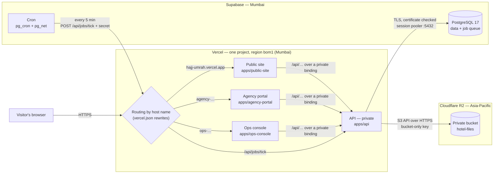
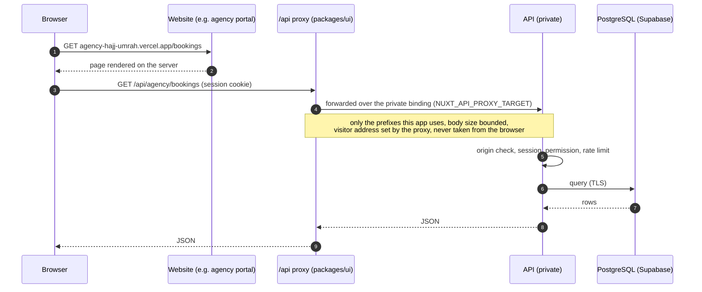
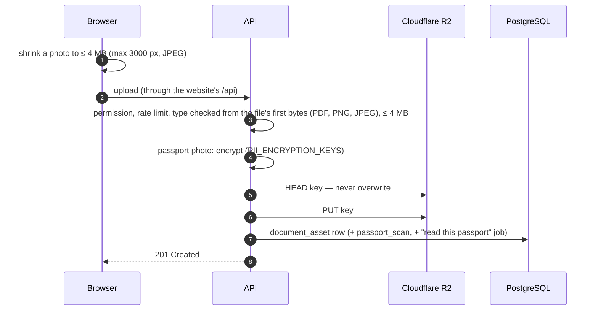
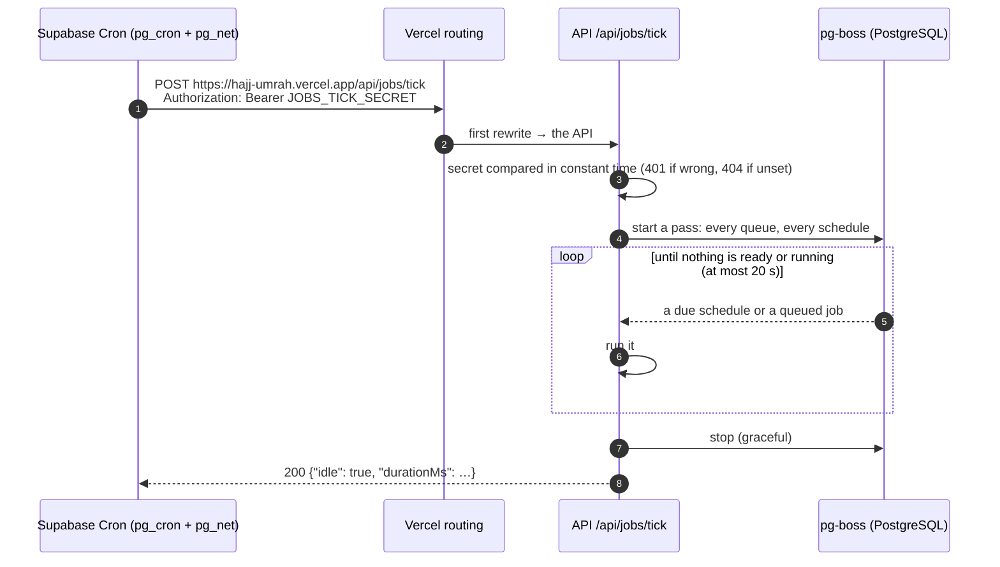
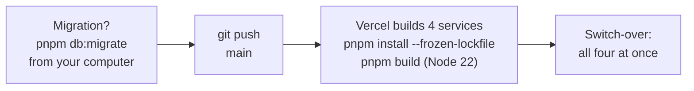

# Deployment architecture (free MVP)

How the system runs once it is deployed on **Vercel**, **Supabase** and **Cloudflare R2** (D-P2-67): what runs
where, how a request, an upload and a background job travel, what is stored where, and how it is protected. The
setup steps are in `docs/DEPLOY_VERCEL.md`; the design reasons behind the application in `docs/ARCHITECTURE.md`.

## 1. The picture

| Service | Its job | Free-plan limit that matters |
|---|---|---|
| **Vercel** | Runs the code: the three websites and the API, HTTPS addresses, builds on every push | 4 h of active CPU a month; non-commercial use only |
| **Supabase** | Stores the data (PostgreSQL) and runs the 5-minute job timer (Cron) | 500 MB database, 5 GB of data out a month, no backups |
| **Cloudflare R2** | Stores the files: hotel documents and passport photos | 10 GB, downloads free |
| **GitHub** (`sumoncse19/hajj-umrah`) | Holds the code; a push to `main` deploys | — |

Not used: Redis (PostgreSQL does its work, §8), Supabase Auth and its Data API (the app has its own sign-in; the Data
API is turned off), Docker (only for local development and a later always-on worker).

## 2. The parts

| Part | Code | Runs as | Reached by |
|---|---|---|---|
| Public site | `apps/public-site` (Nuxt 4) | Vercel Service (functions) | `hajj-umrah.vercel.app` |
| Agency portal | `apps/agency-portal` (Nuxt 4) | Vercel Service | `agency-hajj-umrah.vercel.app` |
| Ops console | `apps/ops-console` (Nuxt 4) | Vercel Service | `ops-hajj-umrah.vercel.app` |
| Shared layer | `packages/ui` | inside each website | the `/api/**` proxy, shared components, photo shrinking |
| API | `apps/api` (Nuxt/Nitro, Drizzle, postgres.js, pg-boss) | Vercel Service, **private** | the websites' bindings; publicly only `/api/jobs/tick` |
| Contracts | `packages/contracts` | inside the apps | shared types, validation schemas, limits (4 MB uploads) |
| Database schema | `packages/db` | migrations run from a developer's computer | — |
| Database | Supabase PostgreSQL 17 | managed | the API (session pooler) |
| File storage | Cloudflare R2 bucket `hotel-files` | managed | the API (S3 API) |
| Scheduler | Supabase Cron (`pg_cron`) + HTTP calls (`pg_net`) | inside the database | — |

Everything sits near Mumbai (Vercel `bom1`, Supabase "South Asia (Mumbai)", R2 "Asia-Pacific"): close to
Bangladesh and the Gulf, and the API's many database round trips stay short.

## 3. A request

### Routing

Vercel reads the rewrites in `vercel.json` top to bottom; the first match wins:

| Request | Goes to |
|---|---|
| `/api/jobs/tick` (any address) | the API — the only public path into it |
| host starting `agency.` or `agency-` | the agency portal |
| host starting `ops.` or `ops-` | the ops console |
| anything else | the public site |

With a custom domain later (`example.com`, `agency.example.com`, `ops.example.com`) the same rules apply, no code
change.

### A page and its data

- Each website forwards only the `/api` prefixes it uses; anything else is a 404 at the website.
- The browser only ever talks to the website's own address: the session cookie is first-party, no cross-site
  cookies.
- Vercel fills `NUXT_API_PROXY_TARGET` from the binding; nobody sets it by hand.

### What the API checks on every request

1. **Origin** (`server/middleware/csrfOrigin.ts`): a request that changes something must come from one of
   `ALLOWED_ORIGINS` (the three addresses), or it is refused with `CSRF_ORIGIN_MISMATCH`.
2. **Session**: the encrypted cookie is opened and its user's `session_version` compared with the database.
3. **Permission**: the user's roles (RBAC tables) must grant the action, for that organization and, for staff, that
   hotel.
4. **Rate limit** where the route has one (§8).
5. **Input**: validated against the shared schemas (`packages/contracts`) before any work.

Responses carry the security headers of `packages/contracts/constants/securityHeaders.ts` (frames refused, HSTS,
referrer policy), on the API and on the three websites.

## 4. Signing in

| Who | Where | How |
|---|---|---|
| Hotel staff | ops console | email + password (Argon2 hashes); a two-factor code once set up (`STAFF_2FA_ENFORCEMENT=required-roles` makes it mandatory for the chosen roles — off in the demo, required in production) |
| Agency users | agency portal | email + password |
| Customers | public site | a code by text message — **off** until an SMS provider is connected |
| Demo visitors | ops console, agency portal | demo sign-in buttons (`APP_ENV=demo`, `DEMO_SIGN_IN_ENABLED=true`) |

A session is an **encrypted cookie** (`nuxt-auth-utils`, sealed with `NUXT_SESSION_PASSWORD`), set for the one address
that signed in; nothing is stored on the server. The user's `session_version` in the database lets a 2FA change end
older sessions. Changing `NUXT_SESSION_PASSWORD` signs everyone out.

## 5. Data: Supabase PostgreSQL

**Connection.** Only the API connects, through Supabase's **session pooler** (port 5432, IPv4 — Vercel needs it; the
transaction pooler would break prepared statements and the job queue). Every connection is encrypted and Supabase's
certificate is checked (`DATABASE_SSL=verify` with `DATABASE_SSL_CA`): the app's pool, the job queue, the migrations
and the seed scripts alike. Each running copy of the API opens at most 2 connections for the app
(`DATABASE_POOL_MAX`) and 2 for the queue (`JOBS_POOL_MAX`); the pooler's size is raised to 40 because Vercel may run
several copies at once.

**What is stored** (`packages/db/schema`):

| Area | Tables |
|---|---|
| Organizations and access | `organization`, `app_user`, `role`, `permission`, `role_permission`, `user_role`, `user_hotel_access` |
| Hotels and rooms | `hotel`, `hotel_setting`, `floor`, `room_type`, `room`, `room_base_config`, `capacity_period`, `room_capacity_override`, `room_operational_block` |
| Prices | `rate`, `price_quote`, `agency_quota`, `allocation_rule`, `extra_bed_policy`, `booking_setting` |
| Bookings | `booking`, `booking_room`, `booking_guest`, `guest_stay`, `booking_price_line`, `booking_change`, `hotel_task`, `document_sequence` |
| Agencies and customers | `agency`, `agency_user`, `customer`, `otp_challenge` |
| Pilgrims and guest data | `pilgrim`, `booking_guest_detail`, `passport_scan` |
| Files (details only) | `document_asset`, `hotel_document` |
| Security and records | `rate_limit_bucket`, `audit_log`, `pii_access_log`, `event_receipt` |
| Job queue | the `pgboss` schema (pg-boss) |

**Correctness.** Overlapping capacity periods and room blocks are refused by the database itself (exclusion
constraints, the `btree_gist` extension). A hold locks the rooms it takes inside one transaction, so two agencies
asking for the last seat at once cannot both get it. A hold that runs out frees its seats at once: availability
ignores it even before the expiry job marks it.

**Personal data.**
- Passport numbers, guest details and passport-reading results are **encrypted by the API** before they are saved
  (`PII_ENCRYPTION_KEYS`, a key ring: `k1:…`, later `k2:…`): unreadable in Supabase's dashboard or a stolen copy.
- Searching by passport number uses a separate keyed hash (`PII_LOOKUP_KEY`), never the number.
- `pii_access_log` records who saw which personal data and when — ids and field names, never the values.
- `audit_log` records the changes people make.
- Losing `PII_ENCRYPTION_KEYS` loses all of that data for good.

**Schema changes** are migrations (`packages/db/migrations`), run from a developer's computer with `pnpm db:migrate`
**before** the code that needs them is pushed; new permissions reach existing organizations with `pnpm rbac:sync`.

## 6. Files: Cloudflare R2

The bucket `hotel-files` is **private**: no public address, no custom domain. Only the API reaches it, with a key
limited to that one bucket (Object Read & Write), over HTTPS through the S3 API (`STORAGE_DRIVER=s3`,
`S3_REGION=auto`). The database keeps each file's details; R2 keeps the bytes, under a server-made name
(`<organization-id>/<year>/<random-id>.<ext>`) with no file name or personal data in it.

### An upload

If saving the row fails after the upload, the API deletes the file again, so no orphan is left.

### A download

The API checks the user's permission, fetches the object from R2, decrypts it if it is a passport photo, and sends it
with `Cache-Control: private, no-store`. Nobody downloads from R2 directly. R2 charges nothing for downloads, so
viewing files never uses Supabase's 5 GB a month.

### Lifecycle

- Hotel documents are archived, never deleted by the app.
- Passport images past their retention period (and discarded ones) are deleted, from R2 and the database, by the daily
  retention job.
- Fallback: Supabase Storage works the same way with its own endpoint, region and key (`docs/DEPLOY_VERCEL.md`
  step 2) — 1 GB, and its downloads count toward Supabase's 5 GB.

## 7. Background jobs: the 5-minute tick

The queue is **pg-boss**, kept in PostgreSQL (`pgboss` schema). The API's functions only **add** jobs
(`JOBS_MODE=send`); nothing runs all the time. Every 5 minutes Supabase Cron starts one pass:

A pass usually takes about 3 seconds and 0.03–0.15 s of CPU. A schedule missed between ticks runs once at the next
one (`missed: 'once'`; every scheduled job is a safe-to-repeat sweep).

| Job | When (UTC; Dhaka is UTC+6) | What it does |
|---|---|---|
| `booking.hold-expiry` | every tick | marks holds that ran out EXPIRED and releases their quotes |
| `booking.quote-expiry` | hourly at :05 | expires quotes that were not taken up |
| `booking.passport-read` | the tick after an upload | reads the photo; no reader is configured, so it goes to manual review |
| `booking.details-reminder` | 06:00 (12:00 Dhaka) | texts bookers whose pilgrims' details are missing near check-in — SMS off: nothing sent |
| `booking.guest-data-retention` | 02:15 | erases pilgrims' details the set number of months after their stay's check-out |
| `booking.passport-retention` | 02:30 | deletes passport images past their retention, and discarded ones |
| `security.cleanup` | 03:17 (run at 03:20) | drops rate-limit counters and sign-in codes long past their window or expiry |
| `events.receipt-prune` | 03:45 | prunes the records of handled events |
| `notify-booker` | after staff confirm or cancel a booking | texts the booker — SMS off: nothing sent |

The tick's secret lives in Vercel (`JOBS_TICK_SECRET`) and in Supabase's cron table (readable by its administrators
only). On a paid plan or a server, an always-on worker (`Dockerfile.worker`) can replace the tick without code changes.

## 8. Security

| Concern | How it is handled |
|---|---|
| Traffic | HTTPS for visitors (Vercel); TLS with a checked certificate to the database; HTTPS to R2 |
| The API's exposure | private service, reached only through the websites' bindings; the tick path needs a secret |
| Forged requests | origin check against `ALLOWED_ORIGINS` on every request that changes something |
| Sessions | encrypted, secure cookies per address; no server-side session store |
| Passwords | Argon2 hashes; staff two-factor |
| Personal data | field encryption, encrypted passport photos, keyed lookup hashes, access log |
| Files | private bucket, key limited to it, no public links, permission checked on every download |
| Abuse | rate limits counted in PostgreSQL (`rate_limit_bucket`) and shared by every running copy: sign-in (per address, per account), two-factor attempts, sign-in codes, agency registration, quotes, holds, searches, the public catalogue, passport uploads and views, personal-data reveals |
| Browser hardening | security headers on the API and the websites (no framing, HSTS, referrer policy) |
| Database exposure | Supabase's Data API turned off: its tables are not published on the web |
| Secrets | only in Vercel's Production settings (previews get none), generated with `openssl` |

Rate limits store a hash of the visitor's address, never the address. Whether Vercel's internal calls keep the
visitor's address can only be checked after deploying (`docs/DEPLOY_VERCEL.md` step 8.5); if they do not, every
visitor shares one limit.

## 9. Configuration

All settings are Vercel environment variables for **Production only**; the API checks them at startup and refuses to
start, naming the setting, when one is missing or wrong. Values are in `docs/DEPLOY_VERCEL.md` step 5.

| Group | Settings |
|---|---|
| Mode | `APP_ENV=demo`, `DEMO_SIGN_IN_ENABLED`, `NUXT_PUBLIC_ORGANIZATION_SLUG` |
| Database | `DATABASE_URL`, `DATABASE_SSL=verify`, `DATABASE_SSL_CA`, `DATABASE_POOL_MAX` |
| Sessions and keys | `NUXT_SESSION_PASSWORD`, `PII_ENCRYPTION_KEYS`, `PII_LOOKUP_KEY` |
| Requests | `ALLOWED_ORIGINS`, `TRUST_PROXY`, `NUXT_API_PROXY_TRUST_PROXY` (`NUXT_API_PROXY_TARGET` comes from the binding) |
| Jobs | `JOBS_MODE=send`, `JOBS_POOL_MAX`, `JOBS_TICK_SECRET` |
| Files | `STORAGE_DRIVER=s3`, `S3_ENDPOINT`, `S3_REGION`, `S3_BUCKET`, `S3_ACCESS_KEY_ID`, `S3_SECRET_ACCESS_KEY`, `S3_FORCE_PATH_STYLE` |

## 10. Deploying a change

- All four services build and go live together; visitors keep the old version until the new one is ready.
- A rollback (Vercel dashboard) returns to an earlier build of all four; it does not undo database migrations.
- Supabase and R2 keep their data across deploys.
- Other branches get preview builds without settings: they do not reach the demo data, by design.

## 11. Limits and what is not live

| Area | State |
|---|---|
| Vercel free plan | non-commercial use only; 4 h of CPU a month (ticks use about 1–2 CPU minutes a day); logs kept one hour |
| Jobs | every 5 minutes, not continuous |
| Uploads | at most 4 MB (photos are shrunk in the browser; a larger PDF must be made smaller) |
| Backups | none automatic: `pg_dump` and a bucket copy by hand (`docs/DEPLOY_VERCEL.md`, "Backups") |
| Supabase | a project idle for a week is paused (restore it from the dashboard); PostgreSQL 17 (tests run on 16) |
| Text messages | not connected: customer sign-in, booking messages and reminders are off |
| Passport reading | no reader configured: every photo goes to manual review |
| Data | demo data only — where pilgrims' data may be stored is still an open client question |

## 12. Beyond the free setup

Nothing in the code is tied to these providers:

- **Vercel Pro**: commercial use, more CPU, and the worker as an always-on Daemon instead of the tick.
- **Supabase Pro**: daily backups and point-in-time recovery.
- **A server or another host**: the API (`node .output/server/index.mjs`), the worker (`Dockerfile.worker`), any
  PostgreSQL with TLS, and R2 as it is (or a lasting disk with `STORAGE_DRIVER=local`).
- **Production settings** (`APP_ENV=production`, staff two-factor, an SMS provider, Turnstile): `docs/DEPLOY_CHECKLIST.md`.
